<picture>
  <source media="(prefers-color-scheme: dark)" srcset="assets/readme-banner-dark.svg">
  
</picture>

[](https://github.com/bmap02/Cortex/releases/latest)
[](#)
[](https://github.com/bmap02/Cortex/actions/workflows/ci.yml)
[](LICENSE)


A lightweight AI agent for your terminal that runs entirely on your machine, on
Windows, macOS and Linux. It is a single ~5 MB Rust binary with no telemetry, and it talks to **Ollama** or
**any OpenAI-compatible server** (llama.cpp, LM Studio, vLLM, LocalAI, Jan).

> [!NOTE]
> Cortex is in early development (0.x). Expect rough edges and changes between versions, including to
> commands and settings. Bug reports and ideas are welcome in [Issues](https://github.com/bmap02/Cortex/issues).

<p align="center">
  
</p>

- **Streaming chat** with history, multi-line input and Tab-completed `/commands`
- **Markdown rendering** as replies stream in: headings, bold, italics, strikethrough, clickable links,
  lists, quotes and syntax-highlighted code blocks that copy cleanly (piped output and `NO_COLOR=1`
  give plain Markdown)
- **Agent tools**: read, write, patch, list and search files; run shell commands and Python;
  exact math; long-term memory
- **Approval before changes**: shell commands, Python, file writes, web fetches and new memories ask y/n/always first, and
  one "no" stops the agent and hands control back to you
- **Cross-platform**: PowerShell on Windows, `sh` on macOS/Linux, colors in every modern terminal
- **Sessions** are saved automatically and can be resumed with `cortex -r`, or `/resume last` in a chat
- **Context management**: `/compress`, plus automatic compression when the context is ~85% full
- **One-shot and pipe mode**: `git diff | cortex run -q "write a commit message"`
- **Offline by default**: the `fetch_url` web tool stays off until you enable it

## Quick start

```powershell
# Windows (PowerShell)
irm https://raw.githubusercontent.com/bmap02/Cortex/main/install.ps1 | iex
```

```bash
# macOS / Linux
curl -fsSL https://raw.githubusercontent.com/bmap02/Cortex/main/install.sh | sh
```

Then open a new terminal (on macOS/Linux, if the installer printed a PATH line, add it first) and,
with [Ollama](https://ollama.com/download) running and a model pulled (`ollama pull qwen2.5:7b`):

```bash
cortex setup
cortex
```

The full guide is below.

## Installation

Cortex runs on **Windows 10/11, macOS and Linux**. You need two things: a model server
(the program that actually runs the AI) and the `cortex` binary.

### Step 1: Install a model server

The easiest option is **Ollama**:

| OS | Command |
|---|---|
| Windows | `winget install Ollama.Ollama` (or the installer from [ollama.com/download](https://ollama.com/download)) |
| macOS | `brew install ollama` (or the app from [ollama.com/download](https://ollama.com/download)) |
| Linux | `curl -fsSL https://ollama.com/install.sh \| sh` |

Then download a model that supports tool calling:

```bash
ollama pull qwen2.5:7b        # ~4.7 GB; good all-rounder for 8 GB+ of VRAM
ollama pull qwen2.5:3b        # smaller, for laptops
```

You can use **LM Studio**, **llama.cpp**, **vLLM**, **LocalAI** or **Jan** instead; Cortex
speaks their OpenAI-compatible API too.

### Step 2: Install Cortex

#### Windows (recommended)

```powershell
irm https://raw.githubusercontent.com/bmap02/Cortex/main/install.ps1 | iex
```

This downloads `cortex.exe` to `%LOCALAPPDATA%\Programs\cortex` and adds that folder to your
PATH (no admin rights needed). **Open a new terminal** afterwards so the PATH change applies.

#### Windows: build from source with one click

If you'd rather build Cortex yourself, download the source (**Code → Download ZIP**), unzip it, open the
folder and **double-click `install-windows.cmd`**. It installs anything that's missing and sets
everything up:

1. Microsoft C++ Build Tools (Rust needs them on Windows; Windows asks for admin permission)
2. Rust
3. Cortex itself (`cortex.exe` goes on your PATH)
4. Ollama, and starts its server
5. A model: it suggests one based on your RAM, or lets you pick one you already have
6. Cortex's config, then runs `cortex doctor`

Running it again is safe: finished steps are skipped. From PowerShell you can also run
`powershell -ExecutionPolicy Bypass -File .\install-windows.ps1 -Model qwen2.5:7b`.

#### macOS / Linux

```bash
curl -fsSL https://raw.githubusercontent.com/bmap02/Cortex/main/install.sh | sh
```

This installs to `~/.local/bin/cortex`. If that folder isn't on your PATH yet, the script prints the
commands to add it. (On Ubuntu and Debian, `~/.profile` adds it automatically, but only at login: if
the folder is new, log out and back in, or run `. ~/.profile`.)

`install.ps1` and `install.sh` accept `CORTEX_VERSION=v0.1.0` to pin a version, `CORTEX_INSTALL_DIR` to change
the location and `CORTEX_RELEASES_URL` to download from a mirror. Both check the download against the
release's `SHA256SUMS.txt` and stop if it doesn't match.

#### Manual download

Grab the archive for your system from the [Releases page](https://github.com/bmap02/Cortex/releases),
unzip it and put `cortex` (or `cortex.exe`) somewhere on your PATH.

| System | File |
|---|---|
| Windows (x64, also runs on ARM) | `cortex-x86_64-pc-windows-msvc.zip` |
| macOS Apple Silicon | `cortex-aarch64-apple-darwin.tar.gz` |
| macOS Intel | `cortex-x86_64-apple-darwin.tar.gz` |
| Linux x64 | `cortex-x86_64-unknown-linux-gnu.tar.gz` |
| Linux ARM64 | `cortex-aarch64-unknown-linux-gnu.tar.gz` |

#### Build from source

1. Install Rust from [rustup.rs](https://rustup.rs). On Windows, run `rustup-init.exe` and accept
   its offer to install the Visual Studio C++ build tools (or run `winget install Rustlang.Rustup`).
2. Build and install:

```bash
cargo install --git https://github.com/bmap02/Cortex
# or, from a clone of this repo:
cargo install --path .
```

`cargo install` puts the binary in `~/.cargo/bin` (`%USERPROFILE%\.cargo\bin` on Windows), which
rustup already added to your PATH.

### Step 3: Connect and check

```bash
cortex setup     # choose Ollama or OpenAI-compatible, the URL and a model
cortex doctor    # checks the server, the model, tool calling, the shell and Python
cortex           # start chatting
```

### Windows notes

- **The banner** needs a window at least 96 columns wide; narrower windows get a one-line header.
  Set `CORTEX_ASCII=1` to always use the one-line header.
- **Shell commands** run in PowerShell 7 (`pwsh`) if it's installed, otherwise Windows PowerShell.
  Cortex tells the model which shell it has, so it writes PowerShell rather than bash.
- **The `run_python` tool** needs Python: `winget install Python.Python.3.12`. The fake "python"
  that opens the Microsoft Store doesn't count; Cortex skips it and uses the `py` launcher.
- **Settings** live in `%USERPROFILE%\.cortex\`.
- **SmartScreen**: the binaries aren't code-signed, so if you download `cortex.exe` by hand Windows
  may warn on first run. Choose **More info → Run anyway**. The install script removes this flag
  for you.

### Updating and uninstalling

Run `cortex update` (v0.1.2 and later) to get the latest release, or run the install command again.
`cortex update` also refreshes the list of models Cortex recommends, even when Cortex itself is up to date.
Both work even while Cortex is open. `cortex update` checks GitHub for a newer release, then runs the
installer for the folder the current `cortex` is in, so a `cargo install` build is replaced by the
release build in place. To keep building from source instead, get the new source first: run `cargo install --git https://github.com/bmap02/Cortex` again,
`git pull` before `cargo install --path .`, or download a fresh ZIP before running
`install-windows.cmd` (note that it also re-applies its Ollama settings to your config).

To uninstall, run `cortex uninstall` (v0.1.2 and later). It removes the `cortex` you're running and
asks separately before deleting your settings, memory and saved conversations in `~/.cortex`. When
Cortex was installed with the install script on Windows, it also takes its folder off your PATH again.

Or remove it by hand: delete the binary and the settings folder.

```powershell
# Windows
Remove-Item "$env:LOCALAPPDATA\Programs\cortex" -Recurse -ErrorAction SilentlyContinue
Remove-Item "$env:USERPROFILE\.cortex" -Recurse
```

```bash
# macOS / Linux
rm -f ~/.local/bin/cortex; rm -rf ~/.cortex
```

If you built from source, run `cargo uninstall cortex` instead of deleting the binary. The one-click
Windows build also leaves its build cache in `%LOCALAPPDATA%\cortex-build`, which you can delete.

### Publishing a release (maintainers)

Binaries are built by GitHub Actions. To publish a new version:

1. Bump `version` in `Cargo.toml`, then run `cargo update -w` so `Cargo.lock` picks up the new version
   (CI and the release build use `--locked` and fail if they disagree).
2. Commit and push both files.
3. Tag the new version and push the tag (replace `vX.Y.Z` with it, e.g. `v0.1.2`):

```bash
git tag vX.Y.Z && git push origin vX.Y.Z
```

The Release workflow builds every platform and attaches the archives and `SHA256SUMS.txt` to a new
GitHub Release. The install scripts always download the latest release. If a release ever ends up
without its files, open the tag's Release run in the Actions tab and choose **Re-run failed jobs**.

## Model servers

```bash
cortex setup
```

Choose **1) Ollama** or **2) OpenAI-compatible**, enter the URL and pick a model. Cortex tests the
connection and lists the models on the server. On an empty Ollama install it offers to download one.

| Server | URL |
|---|---|
| Ollama | `http://localhost:11434` |
| LM Studio | `http://localhost:1234/v1` |
| llama.cpp `llama-server` | `http://localhost:8080/v1` |
| vLLM | `http://localhost:8000/v1` |

`cortex doctor` checks the server, the model and tool calling.

**Pick a model that supports tool calling** for agent features, e.g. `qwen2.5` / `qwen3`,
`llama3.1`+, `mistral-nemo` or `granite3.x`. Models without tool support still work as plain chat;
Cortex detects this and switches automatically. For llama.cpp, start the server with `--jinja` so
tool calls work.

If a model answers with raw JSON like `{"name": "run_shell", "arguments": ...}`, it is writing its tool
calls as text instead of making them; try another model (the `qwen2.5-coder` builds do this now and
then). With "thinking" models such as `qwen3`, `cortex config set think false` gives faster, more direct
answers; `auto` goes back to the model's default.

## Usage

```bash
cortex                          # interactive chat (default)
cortex -m qwen2.5:7b            # use a different model for this run
cortex --ctx 32k                # bigger context window for this run
cortex -r                       # resume the latest session (or: cortex -r <id>)
cortex run "what's in this repo?"
cat error.log | cortex run -q "what went wrong?"
cortex run --no-tools "explain ownership in Rust"   # plain answer, no tool use
cortex models                   # list models on the server
cortex models recommend         # models that suit this machine, best first (offline)
cortex models install 1 --use   # download a recommended one (Ollama) and switch to it
cortex models pull qwen2.5:7b   # download any Ollama model by name
cortex models import hf.co/bartowski/Qwen2.5-7B-Instruct-GGUF:Q4_K_M   # a GGUF from Hugging Face
cortex models import https://example.com/model.gguf --name my-model    # or from any URL
cortex model qwen2.5:7b         # set the default model
cortex memory list              # long-term memory notes; also: show <note>, search <words>, links <note>
cortex memory delete <note>     # delete one note (or `cortex memory clear` for all of them)
cortex tools                    # list tools; cortex tools disable run_shell
cortex tools enable fetch_url   # let the agent read web pages (turns on network access)
cortex config                   # show settings; cortex config set num_ctx 16384
cortex sessions                 # list saved sessions
cortex sessions delete <id>     # remove one
cortex sessions clear           # remove all (asks first; -y to skip)
cortex update                   # update to the latest release
cortex uninstall                # remove Cortex (asks before deleting your data)
```

In `run` mode with piped input, nobody is at the keyboard to approve anything, so the tools that
ask first (web fetches included) stay off unless `auto_approve = true`.

### Context window

The context window is how much of the conversation the model can see at once. The default is
8k tokens. Raise it with `/context 32k` in a chat (saved as your default), `cortex config set num_ctx 32k`,
or `cortex --ctx 32k` for a single run. `/context` on its own shows the current size and the model's
maximum. Bigger windows use more GPU memory; if replies suddenly get much slower, the model has spilled
into system RAM, so step back down. With an OpenAI-compatible server, the server's own limit
(llama.cpp `-c`, LM Studio's context slider) still applies.

### In-chat commands

| | |
|---|---|
| `/help` | list all commands |
| `/model [name]` | show or switch the model |
| `/models` `/tools` | list models / tools |
| `/new` | fresh conversation; clears the screen |
| `/retry` `/undo` | regenerate / drop the last exchange |
| `/compress` | summarize the conversation to free context |
| `/usage` | token counts and context fill |
| `/context [size]` | show or change the context window, e.g. `/context 32k` (saved as default) |
| `/memory` `/forget` | list / delete long-term memory |
| `/sessions` `/resume <id>` | saved conversations; `/resume last` picks up the previous one |
| `/sessions clear` `/sessions delete <id>` | remove all / one saved session |
| `/yolo` | toggle auto-approve |
| `/system` | show the system prompt |
| `/exit` | quit (also Ctrl+D) |

Ctrl+C stops a reply or a running command. End a line with `\` to keep typing on the next line.

## Files

Everything lives in `~/.cortex/` (`%USERPROFILE%\.cortex\` on Windows; override with `CORTEX_HOME`):

| | |
|---|---|
| `config.toml` | settings (see below) |
| `memory/` | long-term memory: one Markdown note per fact, with `[[links]]` between notes; edit freely (an older `MEMORY.md` is converted to notes and kept as `MEMORY.md.bak`) |
| `SOUL.md` | optional persona or extra instructions added to every chat |
| `sessions/` | saved conversations (JSON) |
| `history.txt` | your input history |

```toml
backend = "ollama"            # or "openai"
base_url = "http://localhost:11434"
model = "qwen2.5:7b"
api_key_env = ""              # name of an env var with a key, if your server needs one
num_ctx = 8192                # context window; also /context 32k or `cortex --ctx 32k` for one run
temperature = 0.7
# think = false               # Ollama thinking on/off for models that support it (default: the model's own)
max_steps = 12                # tool rounds per message
auto_approve = false
allow_network = false         # enables fetch_url
show_banner = true
disabled_tools = []
memory_budget = 0.1           # share of the context window for recalled memories (0 = off)
```

## Project layout

```
src/main.rs      the `cortex` CLI: interactive loop, slash commands, setup & doctor
src/turn.rs      shows an agent turn: streamed reply, tool lines, approval prompt, stats
src/ui.rs        banner, colors, status line
src/markdown.rs  streaming Markdown rendering for replies
crates/cortex-core/              the core library the CLI is built on (never prints):
crates/cortex-core/src/agent.rs     agent loop on a worker thread, its events, sessions, compression
crates/cortex-core/src/backend.rs   Ollama + OpenAI-compatible streaming clients
crates/cortex-core/src/tools.rs     tool schemas and implementations
crates/cortex-core/src/config.rs    settings and the Cortex home folder
crates/cortex-core/src/cancel.rs    the per-session handle that stops a turn
crates/cortex-core/src/calc.rs      calculator
crates/cortex-core/src/hardware.rs  RAM, GPUs and their VRAM, unified memory, OS and CPU of this machine
crates/cortex-core/src/recommend.rs which catalog models suit the hardware (a pure function)
crates/cortex-core/src/import.rs    importing GGUFs from Hugging Face or a URL into Ollama
crates/cortex-core/src/memory.rs    long-term memory: Markdown notes, wikilinks, BM25 search
crates/cortex-core/catalog.toml     the curated model catalog bundled into the binary
crates/cortex-core/tests/session.rs drives agent turns against the fake model server
tests/mock_server.py   fake Ollama/OpenAI server for testing without a model
install.sh / install.ps1   one-line installers (download a release)
install-windows.cmd/.ps1   all-in-one Windows installer (builds from source)
.github/workflows/     CI on Windows, macOS & Linux; release builds on version tags```

Run the tests with `cargo test` (the core's session tests need Python, for the fake model server). For an end-to-end check without a GPU, start
`python3 tests/mock_server.py 11999` and point Cortex at `http://127.0.0.1:11999` (Ollama) or
`http://127.0.0.1:11999/v1` (OpenAI).

Licensed under the [Apache License 2.0](LICENSE).
